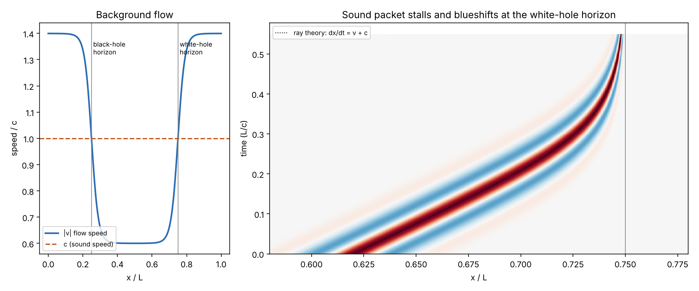
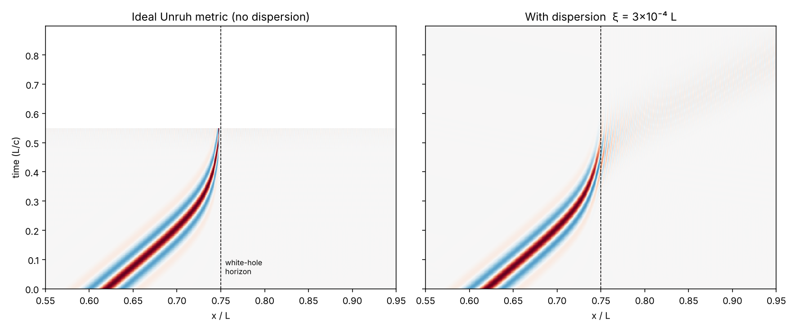
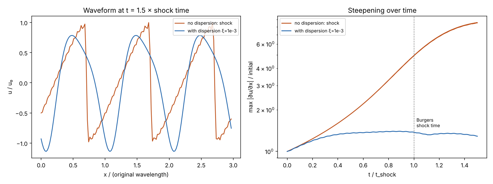
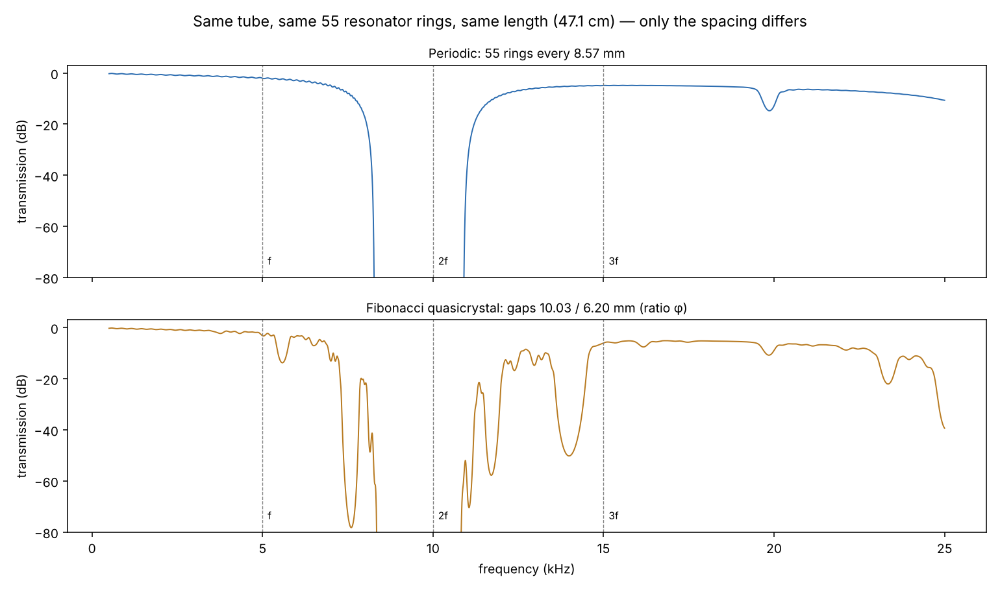
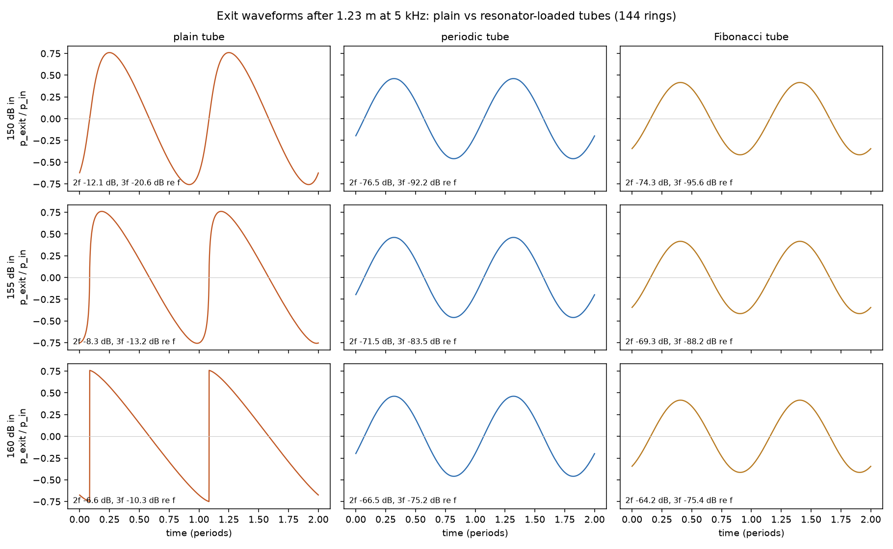
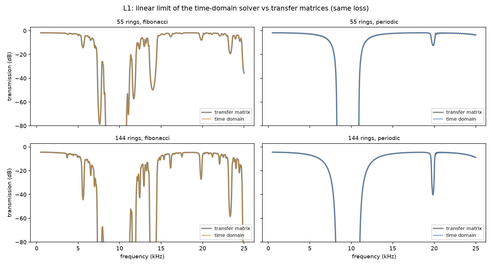
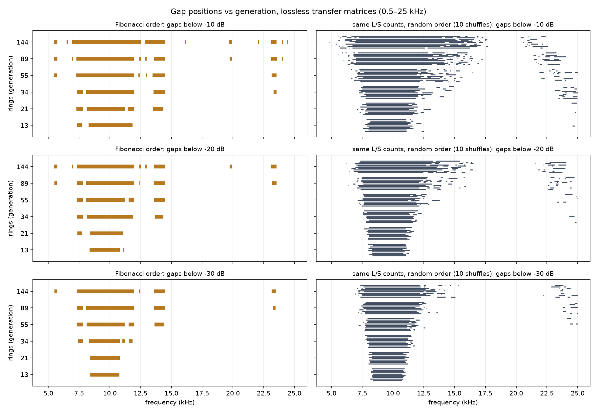
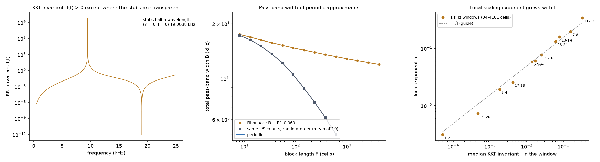

# Analog Gravity & Nonlinear Acoustics Lab

Sound in moving air obeys the same wave equation as a field in curved spacetime
(Unruh, 1981). This folder simulates that "acoustic metric," adds the effects a
real medium has (dispersion, shock steepening, viscosity), and turns the results
into bench experiments.

**Rule for everything here: every simulation checks itself against a known
answer before its results are trusted.** Run any script and it prints PASS/FAIL.

Runs on CPU by default; `ANALOG_GRAVITY_DEVICE=cuda` puts the spectral solvers
on a GPU, but at these sizes that's slower.

> Performance notes: at these grid sizes (N ≤ 4096, float64) a GPU doesn't help.
> ~87% of GPU time is 4096-point FP64 cuFFT (~38 µs each): one small FFT can't
> fill the GPU, and consumer GPUs run FP64 at 1/64 rate; per RK4 step the CPU is
> ~2× faster than an RTX 5090. Removing GPU→CPU syncs from the time loops didn't
> change run times. What did help (idle machine, 3 runs each, every check printing
> the same numbers — the only changes are two energy drifts at round-off level,
> e.g. 2.67e-14 → 1.93e-14):
>
> | Script | Before | After | Speedup | How |
> |---|---|---|---|---|
> | `sonic_horizon.py` | 99–103 s | 40–41 s | 2.5× | CPU; 6 → 4 real FFTs per RHS; both T2 packets as one batched run |
> | `sonic_horizon_physical.py` | 231–236 s | 39–40 s | 6.0× | CPU; 14 → 4–5 real FFTs per RHS (all linear terms in Fourier space) |
> | `kdv_test.py` | 93–97 s | 15 s | 6.3× | same solver changes (both at N = 1024; the comparison runs now use N = 4096, ~160 s — see section 3) |
> | `tube_shock.py` | 840–971 s | 39–129 s (100 s incl. numba compile) | ~16× typical | numba step loop (bitwise identical to the numpy loop, which remains as a fallback); 9 independent runs in parallel processes |
>
> The `tube_shock.py` after-times vary run to run (42, 39, 53 s steady; one
> unexplained 129 s outlier).

```bash
pip install torch numpy matplotlib numba   # numba optional (tube_shock.py ~15x slower without)
python sonic_horizon.py            # phase 1: ideal acoustic metric
python sonic_horizon_physical.py   # phase 2: dispersion, shocks, viscosity
python kdv_test.py                 # shock vs dispersion
python resonator_tube_design.py    # bench-build feasibility numbers
python fibonacci_tube.py           # golden-ratio quasicrystal tube
python tube_shock.py               # does the resonator tube stop the shock? (~1 min with numba)
python fibonacci_sweep.py          # quasicrystal or not? generation sweep + random control
python fibonacci_trace_map.py      # KKT trace map: critical scaling vs controls (~6 min)
```

---

## 1. Sonic horizon on the Unruh metric — `sonic_horizon.py`

Solves (1/√−g) ∂μ(√−g g^μν ∂ν ψ) = 0 on
ds² = (ρ/c)[−(c² − v²)dt² − 2v dt dx + dx²], with a flow that crosses the speed
of sound twice (a black-hole and a white-hole horizon). Pseudo-spectral + RK4.

| Test | Result |
|---|---|
| Still air: packet speed = c | 1.0000 |
| Moving air: speeds = v ± c | 0.5000 / −1.5000 |
| Conserved energy | drift ~10⁻¹⁴ |
| Packet position & wavenumber vs ray theory | agree within 0.4% |
| Packet never crosses the white-hole horizon | ✓, blueshifted 20× |



## 2. Real-medium effects — `sonic_horizon_physical.py`

| Effect | Test | Result |
|---|---|---|
| Dispersion ω² = c²k² + ξ²k⁴ | phase speed vs formula | match to 5 decimals |
| Viscosity | decay rate νk²/2 | match within 0.03% |
| Nonlinear steepening | shock time vs Burgers t_s = 1/(βεkc) | 0.3790 vs 0.3789 |

**Bug found and fixed:** the originally proposed nonlinear term (`v_eff = v + β ψ_x`)
steepened shocks exactly 2× too fast, because v_eff appears in two advection
terms. The correct coefficient is β/2. The Burgers test caught it.

**Horizon result:** in the ideal metric the wave piles up at the white hole (1%
gets through). With dispersion, the squeezed wave turns into fast short ripples
that escape — essentially 100% through by t = 0.9. Exact escape wavenumber
(solve v_g = 1.4c): k* = 1,817; measured ≈ 1,800.



## 3. Shock vs dispersion — `kdv_test.py`

At 160 dB in air (acoustic Mach ≈ 0.014) a 40 kHz wave shocks after ~9.4
wavelengths ≈ **8 cm** — the practical ceiling on acoustic levitation. (The
9.47 wavelengths / 8.1 cm printed by `sonic_horizon_physical.py` use the rounded
ε = 0.014, i.e. 159.9 dB; exactly 160 dB gives ε = 0.01412 and 9.39 wavelengths
= 8.05 cm — see the check in section 4.) With
strong model dispersion (ξ = 10⁻³) the shock never forms (gradient plateaus at
1.4×), but no soliton train appears at that setting either (1 pulse per original
wavelength in both runs, counting only peaks with prominence > 0.3 u₀ so
grid-scale wiggles on the shock front aren't mistaken for pulses).
Real air's dispersion length (~70 nm) is far too small to help at 40 kHz.

| Check | Test | Result |
|---|---|---|
| K1 | escape wavenumber from the Newton solve: v_g(k*) = 1.4c (complex-step derivative of ω(k)) | error 0.0 (limit 10⁻⁹) — PASS |
| K2 | separate inviscid run (ν = 0, N = 4096) must track Burgers (B1 method: gradient 5× at 0.8 t_s, 5%) | 0.3790 vs 0.3789 — PASS |
| K3 | the actual ν = 10⁻⁵ shock run vs the exact viscous Burgers solution (Cole–Hopf, diffusivity ν/2 as measured by V1): waveform rms < 1% of u₀, peak gradient within 2% | N = 4096: rms 0.09%; peak gradient 11.10× vs exact 11.12× — PASS (failed at N = 1024, below) |

**K2 failed on its first run.** It was first applied to the ν = 10⁻⁵ comparison
run and reached 5× at 0.4762 vs 0.3789 (26% late). The cause is that run's
viscosity, not the grid: with ν = 0 the same N = 1024 run reaches 5× at
1.04 × 0.8 t_s and N = 4096 at 1.00×; with ν = 10⁻⁵ even N = 4096 is 22% late.
ν = 10⁻⁵ gives a Gol'dberg number of only βε/(νk) ≈ 13, so the comparison's
"no dispersion" run is a strongly viscous Burgers shock, not inviscid Burgers.
The comparison runs keep ν = 10⁻⁵; K2 now checks a separate inviscid run, and
K3 checks the viscous run against the right answer for it.

**K3 failed at N = 1024, and the plot was corrected.** The comparison runs were
originally N = 1024, where the ν = 10⁻⁵ viscous shock is only about 0.6 cells
thick: K3 failed (rms 2.41%, peak gradient 8.58× vs exact 11.12×), and the plot
showed the shock gradient saturating at 8.6×. The same run converges to the
exact solution as the grid is refined:

| N | rms error vs exact | peak gradient (exact 11.12×) |
|---|---|---|
| 1024 | 2.41% | 8.58× |
| 2048 | 0.27% | 10.63× |
| 4096 | 0.089% | 11.10× |
| 8192 | 0.088% | 11.12× |

The comparison runs now use N = 4096 (affordable after the speedup; ~160 s on
CPU) with K3's tolerances unchanged, and K3 passes. The plot was regenerated: the
shock's peak gradient now reads 11.1× instead of the under-resolved 8.6×, and the
shock front is smooth instead of a grid-scale staircase. The dispersion result is
unchanged: the ξ = 10⁻³ run's gradient plateau is 1.401× at both N = 1024 and
N = 4096.



## 4. Bench build feasibility — `resonator_tube_design.py`

A tube lined with side resonators tuned so the 2nd harmonic falls in their band
gap should stop a shock from forming (Sugimoto-style). The calculator sizes it
at 40, 10, 5 and 2 kHz and checks the shock actually forms in the plain tube
(Gol'dberg number).

- **5 kHz:** 26.5 mm ID (1" Sch 40 PVC), shock in 1.15 m at 155 dB, 6 quarter-wave
  stubs per ring, rings every 8.6 mm. Straightforward.
- **40 kHz:** the hard version. Levers to make it work: wider tube with a plane
  source, pressurized gas (lower viscous loss), horn-coupled hex array for
  ~160 dB, resin-printed or corrugated (Bragg) wall, schlieren imaging to see
  the shocks directly.

Checks against values worked by hand (derivations in the script), all PASS:
shock distance at 160 dB / 40 kHz = 9.393 wavelengths; the (0,1) cutoff constant
3.832 vs the first zero of J1 computed independently (3.831706); the 5 kHz tube's
(0,1) cutoff = 15/0.95 = 15.789 kHz (above 3f); 5 kHz tube ID 26.50 mm; 5 kHz
wall loss 0.1575 Np/m; shock distance 1.146 m and Gol'dberg number 5.540 at
155 dB / 5 kHz; stub depth 5.648 mm; 2nd harmonic inside the band gap at all four
frequencies.

**First-run failure:** the shock-distance check first expected 9.47 wavelengths
and failed (9.393). The calculator was right: 9.47 comes from ε = 0.014
(159.9 dB), while 160 dB is p₀ = 2000 Pa → ε = 0.01412 →
x_s/λ = ρc²/(2πβp₀) = 9.393. The expected value was corrected.

## 5. Golden-ratio quasicrystal — `fibonacci_tube.py`

Same 55 rings, same length; only the spacing changes. Periodic spacing gives
one clean band gap (8.1–11.2 kHz at −20 dB). Fibonacci spacing (gap ratio φ,
substitution L→LS, S→L) widens the main gap to 7.3–12.0 kHz and adds side gaps,
but how many depends on where you draw the line. Counting gaps (blocked bands
split only by pass-peaks wider than 0.2 kHz, ignoring bands that touch the
0.5–25 kHz sweep edge):

| Threshold | Periodic | Fibonacci |
|---|---|---|
| −10 dB | 2 | 4 |
| −20 dB | 1 | 3 (7.3–12.0, 13.6–14.5, 23.2–23.5 kHz) |
| −30 dB | 1 | 4 (main gap splits into 7.3–7.8, 8.1–11.3, 11.5–12.0; plus 13.6–14.4) |

The robust features at every threshold are the widened main gap and the
13.6–14.5 kHz side gap; the rest come and go with the threshold. Whether the
gap structure is a quasicrystal effect is tested in section 7; whether it
suppresses shocks differently from the periodic tube, in section 6.

Checks (all PASS on the first run): lossless energy conservation
|R|² + |T|² = 1 to 2.5×10⁻¹⁴ (periodic) and 7.0×10⁻¹⁴ (Fibonacci), limit 10⁻⁹;
the periodic tube's gap vs the Bloch condition of the infinite lattice,
cos(qd) = cos(kd) + (iZY/2) sin(kd): Bloch gap 8.280–10.893 kHz, finite lossless
55-ring tube blocks 8.277–10.898 kHz (edges within 5 Hz; limit 150 Hz), and no
blocked band outside a Bloch gap. The 19.65–20.01 kHz Bragg gap is too shallow to
reach −20 dB in 55 cells (17.2 dB predicted, −11.7 dB minimum), so it isn't tested.



## 6. Does the resonator tube stop the shock? — `tube_shock.py`

Time-domain answer to section 5's open question. Same plane-wave duct + side-stub
model as `fibonacci_tube.py`, now with Burgers-type steepening (β = 1.2) and wall
loss. Forward and backward waves each steepen on their own; each ring is 6 closed
quarter-wave stubs joined at a point (pressure continuous, volume flow conserved).
Numerics: a lattice with dx = c·dt, so linear propagation is exact and every ring
sits on a cell boundary (gap lengths within 0.4 µm); steepening is a Godunov
sub-step. The comparison only runs if all validation checks pass.

| Check | Test | Result |
|---|---|---|
| L1 | linear limit vs `fibonacci_tube.T_dB` (same loss), periodic + Fibonacci, 55 + 144 rings | \|T\| within 0.04–0.22 dB where T > −40 dB (limit 0.5); all −20 dB gap edges identical |
| N1 | no stubs: gradient reaches 5× at 0.8 x_s, x_s = 1/(βεk) | 0.5179 m vs 0.5155 m (+0.5%, limit 5%) |
| N2 | zero-area stubs at every ring must reproduce the plain tube | f, 2f, 3f within 0.02 dB |
| C1 | grid convergence, dx vs 2 dx, periodic tube at 160 dB | f, 2f, 3f within 0.01 / 0.05 / 0.55 dB |

**First N1 run failed:** the gradient reached 5× at 0.418 m, 19% early. The
waveform itself matched the exact implicit Burgers solution to 0.07% rms, so the
solver was right and the measurement wasn't: a one-cell finite difference turned
~10⁻³ cell-scale jitter (from the Godunov flux switching at F = 0, i.e. right at
the steepest point) into a spurious gradient. The gradient is now a centred
difference over ±16 cells (0.56 mm, vs a 2.2 mm gradient scale at 5×); the 5%
tolerance is unchanged and the measured gradient tracks 1/(1 − x/x_s) at every x.
A second issue: with 2 transits of settling, the 2f/3f residues in the stub tubes
still drifted by up to 8.5 dB (start-up ringing near the band edges); the runs now
settle for 8 transits and the levels are steady to ≤ 0.13 dB.

**Result** (5 kHz, 144 rings, 1.23 m; exit harmonic levels relative to f; SPL as
peak amplitude, same convention as `resonator_tube_design.py`):

| Input | x/x_s | Plain 2f / 3f | Periodic 2f / 3f | Fibonacci 2f / 3f |
|---|---|---|---|---|
| 150 dB | 0.61 | −12 / −21 dB | −77 / −92 dB | −74 / −96 dB |
| 155 dB | 1.08 | −8 / −13 dB | −72 / −84 dB | −69 / −88 dB |
| 160 dB | 1.92 | −7 / −10 dB (shocked) | −67 / −75 dB | −64 / −75 dB |

- **Both resonator tubes stop the shock.** At 160 dB the plain tube's exit is a
  sawtooth; both loaded tubes deliver a clean sine with harmonics ≥ 64 dB down.
  3f is suppressed even though 15 kHz is in a pass band: it is generated mainly
  from f + 2f, so blocking 2f starves it.
- **Fibonacci spacing doesn't change the answer.** 2f = 10 kHz sits deep in a stop
  band for both layouts; periodic is 1–2 dB better on 2f and passes 0.9 dB more
  of the fundamental.
- **Cost:** the rings' linear loss at 5 kHz takes ~4–5 dB off the fundamental at
  150 dB. At 160 dB the plain tube loses energy in its shock, so the exit
  fundamentals are close (154.7 vs 153.3 dB).

**Caveats:**
- 144 rings (1.23 m), not the 55-ring 47 cm tube of section 5: the 47 cm tube
  never shocks at these levels (x_s ≥ 0.64 m even at 160 dB).
- Stubs are linear (no steepening inside them); cross-modulation between forward
  and backward waves is neglected.
- Wall loss is frequency-independent, set to the Kirchhoff value at 10 kHz (duct
  0.223 Np/m, stubs 0.743 Np/m). Real wall loss grows like √f, so this
  over-damps f by ~1.4× and under-damps 3f by ~1.2×.
- 1-D plane-wave model: no higher duct modes, no stub-mouth near-field beyond the
  0.85 r end correction.
- Runs on CPU (~40–55 s with numba and parallel runs, ~15 min without); a
  lattice of ~35k cells is too small for the GPU to help (see the performance
  notes above).




## 7. Is the Fibonacci gap structure a quasicrystal effect? — `fibonacci_sweep.py`

Gap centres and widths at −10/−20/−30 dB for 13, 21, 34, 55, 89, 144 rings
(successive Fibonacci generations, same average spacing), from **lossless**
transfer matrices so only the structure makes gaps. **Control:** the same numbers
of L and S gaps in random order, 10 shuffles per generation (fixed seed). A gap
"persists" if its centre lies inside a gap of the next generation; it is "new" if
it overlaps no gap of the previous one.

| Rings | Fibonacci gaps (−10 / −20 / −30 dB) | Random gaps, mean of 10 | Fibonacci passband at −10 dB | Random passband at −10 dB |
|---|---|---|---|---|
| 13 | 2 / 2 / 1 | 1.5 / 1.1 / 1.0 | 20.8 kHz | 21.1 kHz |
| 21 | 4 / 2 / 1 | 1.8 / 1.1 / 1.0 | 19.6 kHz | 20.3 kHz |
| 34 | 4 / 3 / 4 | 3.2 / 1.6 / 1.4 | 18.8 kHz | 19.1 kHz |
| 55 | 7 / 4 / 4 | 5.6 / 2.5 / 2.2 | 18.1 kHz | 17.6 kHz |
| 89 | 9 / 6 / 4 | 6.5 / 5.1 / 2.6 | 17.4 kHz | 15.4 kHz |
| 144 | 10 / 8 / 5 | 6.0 / 5.0 / 4.9 | 16.7 kHz | 13.2 kHz |

Against the three parts of the quasicrystal prediction:

- **Existing gaps persist at stable positions: yes for Fibonacci, not for random.**
  Every Fibonacci gap persists into the next generation at every threshold
  (100%), except one 0.11 kHz sliver at −20 dB between 13 and 21 rings. The side
  gaps sit at the same frequencies once they open: 5.6, 7.0, 7.55, 12.4, 12.9,
  14.0, 19.8 and 23.3 kHz (some, e.g. 7.0 and 12.4 kHz at −10 dB, are later
  swallowed by the widening main gap, which counts as persisting). In the random
  layouts only 53–65% of gaps persist by
  55–144 rings at −10 dB (59–65% at −20/−30 dB by 144 rings), and the side gaps
  land at different frequencies in every shuffle.
- **New gaps open each generation: in both orders, so not specific to Fibonacci.**
  From 34 rings on, random layouts open on average 1.9–4.1 new gaps per
  generation at −10 dB (0.4–3.7 at −20/−30 dB) vs 1–4 (0–3) for Fibonacci — about
  as many. In the Fibonacci tube the new gaps open both between existing
  gaps (12.4, 12.9 kHz) and outside them (5.6, 19.8, 23.3 kHz).
- **Total passband shrinks: in both orders, so not specific to Fibonacci.** The
  random layouts lose passband *faster* (21.1 → 13.2 kHz at −10 dB vs 20.8 →
  16.7 kHz for Fibonacci), as expected from disorder alone (wave localization).

So the part of the quasicrystal picture that the Fibonacci order specifically
produces is **reproducible gaps at fixed frequencies that persist generation to
generation**. More gaps and a shrinking passband with length happen with random
order too and can't be credited to the Fibonacci sequence. The main 7–12 kHz gap
comes from the stub resonance itself and is present in every layout. Whether the
spectrum scales like a quasicrystal's is tested properly in section 8.



## 8. Trace map: is the Fibonacci tube a critical quasicrystal? — `fibonacci_trace_map.py`

**Setup.** Each cell of the model (a duct segment, then a ring of stubs) has a
lossless 2×2 transfer matrix with det = 1. With S = d/(1 + φ⁻²) = 6.2013 mm and
L = φS = 10.0339 mm (the infinite chain's gaps, mean spacing d), the Fibonacci
words w₀ = S, w₁ = L, w_{j+1} = w_j w_{j−1} (the same substitution L → LS, S → L
as `fibonacci_tube.py`; w₁₁ is its 144-ring sequence) give M_{j+1} = M_j M_{j−1}
and, for x_j = ½ Tr M_j, the Kohmoto–Kadanoff–Tang trace map

  x_{j+1} = 2 x_j x_{j−1} − x_{j−2},

which conserves I = x²_{j+1} + x²_j + x²_{j−1} − 2 x_{j+1} x_j x_{j−1} − 1 at each
frequency. The periodic approximant built from block w_j passes frequencies with
|x_j| ≤ 1. For the discrete Fibonacci Hamiltonian, Sütő proved that I > 0 makes
the spectrum a Cantor set of zero Lebesgue measure (and purely singular
continuous); the argument runs through the trace-map dynamics, which this tube
shares. It is not proved here for this acoustic model; the numerics below are
consistent with it. The signature to look for: the total pass-band width B_j of
the approximants shrinks as a **power law** in the block length F_j (critical
scaling), unlike a periodic tube (B constant) or a disordered one (localization:
B collapses faster, not as a clean power law).

The matrices act on the dimensionless state (p, Z₀U), Z₀ = ρc/S:
M′ = S⁻¹MS with S = diag(1, 1/Z₀), i.e. [[A, B/Z₀], [CZ₀, D]], and the stub term
becomes Ȳ = Z₀Y = i(S_b/S) tan(k l_eff). Traces and determinants are unchanged.

| Check | Test | Result |
|---|---|---|
| T1 | det(M′_j) = 1 ± 10⁻¹², j = 1..6, where all entries \|M′_j\| ≤ 10 | PASS: max 1.6×10⁻¹³; entries ≤ 10 at 89–97% of frequencies |
| T2 | trace recursion vs explicit products, \|x_rec − x_prod\| / max(1, \|x_prod\|) ≤ 10⁻⁹ where the product is finite | **FAIL**: max 3.0×10⁻⁹ (2584 cells) |
| T3 | I constant along j (\|I_j − I₁\| ≤ 10⁻⁹ max(1, \|I\|) where all three \|x\| ≤ 10); I > 0 on 0.5–25 kHz | PASS: max change 3.8×10⁻¹⁴; min I = 9.8×10⁻¹³ at 19.0038 kHz |
| T4 | B_j within 0.5% between a 0.1 Hz and a 0.025 Hz grid, up to 4181 cells | PASS: 0.036% |
| T5 | 6-cycle (0, 0, √(I+1)): linearization of Φ⁶ has eigenvalues μ, 1, 1/μ with μ + 1/μ = 16(1 + I)² + 2, relative error ≤ 10⁻⁹ | PASS: 4.4×10⁻¹⁶ for I from 10⁻¹² to 8×10⁹ |

**History of T1 and T2.** As first specified — SI matrices (p, U) over the whole
range for T1, and an absolute 10⁻¹⁰ for T2 — both failed by enormous margins
(|det − 1| = 1.6×10¹¹⁹; |x_rec − x_prod| = 4.0×10²⁹²). Both were floating-point
conditioning: Z₀ ≈ 7.5×10⁵ Pa·s/m³ in the SI entries, and stop-band products that
grow as e^{γN} (to ~10⁷¹ at 13 cells), where FP64 can't evaluate AD − BC = 1
without cancellation. T1 was reformulated as above (normalized matrices, masked
to bounded entries) and passes.

**T2 still fails with the relative tolerance, and is left as a finding.** The
recursion is right — the relative error grows smoothly with chain length with no
breakdown: 2.1×10⁻¹⁴ (8 cells), 7.0×10⁻¹³ (34), 4.3×10⁻¹¹ (144), 2.0×10⁻¹⁰
(610), 1.2×10⁻⁹ (1597), 3.0×10⁻⁹ (2584), 1.7×10⁻⁹ (4181). That is rounding
accumulated over thousands of 2×2 products (in the explicit product, the
recursion, or both), so a fixed 10⁻⁹ holds only up to ~1000 cells; passing it
over the full range would need a length-dependent tolerance.

**I(f) > 0 everywhere on the grid.** It vanishes only where the cells stop
scattering: at f_t = c/(2 l_eff) = 19.0038 kHz the stubs are half a wavelength
deep (Y = 0) and the tube is a plain duct; it also falls toward 0 at low
frequency (~10⁻⁶ at 0.5 kHz) as Y → 0.

**Scaling** (total pass-band width of the periodic approximants, 0.5–25 kHz):

| Block length (cells) | Fibonacci | Random order, same L/S counts (mean of 10) | Periodic |
|---|---|---|---|
| 8 | 17.46 kHz | 17.27 kHz | 21.52 kHz |
| 34 | 15.76 kHz | 13.66 kHz | 21.52 kHz |
| 144 | 14.37 kHz | 8.90 kHz | 21.52 kHz |
| 610 | 13.23 kHz | 4.96 kHz | 21.52 kHz |
| 4181 | 11.99 kHz | — | 21.52 kHz |

- **Fibonacci:** B ∝ F^(−0.0601) over 8–4181 cells, rms residual 0.008 in ln B;
  an exponential fits 10× worse (0.075). That is critical, power-law scaling.
  α = 0.0601 is an **aggregate** over 0.5–25 kHz (B shrinks by φ^(−α) = 0.9715
  per generation, 2.8%), not a constant of the tube — see the local exponents
  below.
- **Random order:** much faster collapse that fits neither form cleanly (power
  law −0.29, residual 0.073; exponential residual 0.141): disorder-driven
  localization, not critical scaling.
- **Periodic:** constant, 21.52 kHz at every length.

**Local exponent.** Fitting B ∝ F^(−α) separately in 1 kHz windows (34–4181
cells):

| Window | median I | α | | Window | median I | α |
|---|---|---|---|---|---|---|
| 1–2 kHz | 5.1×10⁻⁵ | 0.003 | | 13–14 kHz | 7.9×10⁻² | 0.157 |
| 3–4 kHz | 1.8×10⁻³ | 0.019 | | 15–16 kHz | 2.4×10⁻² | 0.077 |
| 5–6 kHz | 1.7×10⁻² | 0.060 | | 17–18 kHz | 4.1×10⁻³ | 0.026 |
| 7–8 kHz | 0.16 | 0.195 | | 19–20 kHz | 4.7×10⁻⁴ | 0.007 |
| 9–10 kHz | — | pass band vanishes | | 21–22 kHz | 1.4×10⁻² | 0.058 |
| 11–12 kHz | 0.32 | 0.338 | | 23–24 kHz | 6.1×10⁻² | 0.132 |

The exponent is set by the local coupling: across the windows α ∝ I^0.55 (rms
residual 0.10 in ln α), with α/√I between 0.33 and 0.60. It goes to 0 as I → 0
— no scattering, no shrinkage (the plain-duct limit keeps its full pass band at
every length). The √I trend parallels the weak-coupling regime of the discrete
Fibonacci Hamiltonian, where I scales as the square of the coupling, so α ∝ √I
means α scales roughly linearly with the coupling; that correspondence is an
analogy here, not derived for this model. An earlier heuristic formula,
α(I) = ln λ₁ / (φ ln φ) with λ₁ = (1 + √(5 + 4I))/2, was rejected: it gives
α ≥ 1/φ = 0.618 at every I, the opposite trend to every measured window. Its λ₁
matches the 6-cycle only at I = 0 (μ = φ⁶ there); the exact relation is T5's.

**Bench caveat.** In the infinite limit the Fibonacci spectrum has zero measure,
but it gets there slowly, and how slowly depends on frequency. Where α < 0.03 —
below ~4 kHz and around the 19 kHz transparency point — a finite tube shows
essentially no pass-band erosion: halving B there would take more than 2^(1/0.03)
≈ 10¹⁰ times more cells. Band thinning is concentrated where I is large: around
the stub resonance (7–14 kHz, α up to 0.34) and, to a lesser degree, above
~22 kHz (α ≈ 0.13 at 23–24 kHz). Even at α ≈ 0.34, halving B takes ~8× more
cells, so a lab tube of tens to hundreds of rings is in the weakly critical
regime, not a developed Cantor set. These are lossless transfer matrices; wall
loss would blur the finest gaps first.

(The heuristic alternative — rounding finite-tube gap-width ratios to the
nearest power of φ, and a "dimension" from a −20 dB passband fit — was rejected:
every ratio lies within a factor √φ of some power of φ by construction, Fibonacci
ratios were no closer to powers of φ than random-order ratios (mean distance
0.29 vs 0.26; chance is 0.25), and the "dimension" ranked random order (0.87) as
more fractal than Fibonacci (0.91).)



---

## References
- W. G. Unruh, "Experimental black-hole evaporation?", PRL 46, 1351 (1981)
- M. Visser, "Acoustic black holes", CQG 15, 1767 (1998)
- S. Weinfurtner et al., "Measurement of stimulated Hawking emission in an analogue system", PRL 106, 021302 (2011)
- N. Sugimoto, "Propagation of nonlinear acoustic waves in a tunnel with an array of Helmholtz resonators", JFM 244, 55 (1992)
- M. Kohmoto, L. P. Kadanoff, C. Tang, "Localization problem in one dimension: mapping and escape", PRL 50, 1870 (1983)
- A. Sütő, "Singular continuous spectrum on a Cantor set of zero Lebesgue measure for the Fibonacci Hamiltonian", J. Stat. Phys. 56, 525 (1989)
- M. F. Hamilton & D. T. Blackstock (eds.), *Nonlinear Acoustics*

*Built Oct 18, 2026 — Sportysport74 & Claude (Anthropic). Same license as the rest of this repo.*
